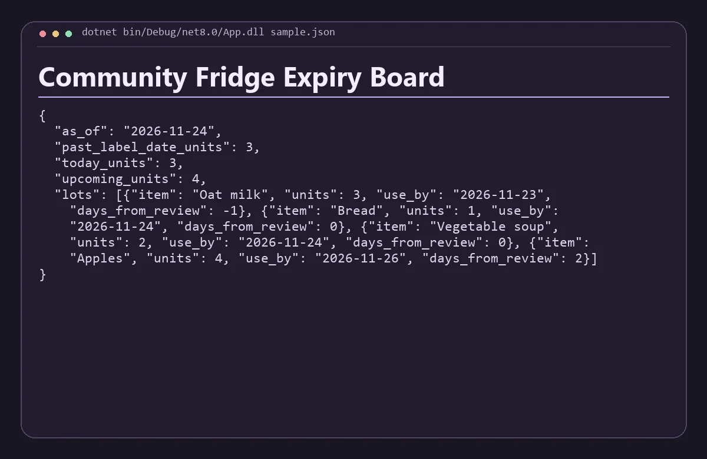

# Community Fridge Expiry Board

Arrange community fridge inventory by its recorded use-by labels and count the units listed before, on, and after a chosen review date.



## Run

Install .NET 8 SDK and runtime. Run these commands from the repository root.

```sh
dotnet build --nologo
dotnet bin/Debug/net8.0/App.dll sample.json
```

Replace `sample.json` with a JSON file following the same structure. The app prints a JSON report to standard output.

Use YYYY-MM-DD for the explicit review date and each lot’s recorded use-by label, with a positive whole number of units per lot. Keep separate lots for different labels. The board sorts by label date and then item name and reports calendar-day differences using the entered dates.

## Verify

Run `python check.py` with Python 3.11 or newer after the build step when applicable. The check verifies the bundled scenario and confirms that an invalid input returns an error.
